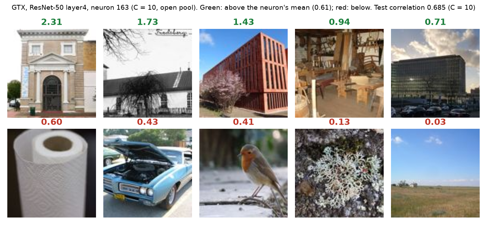
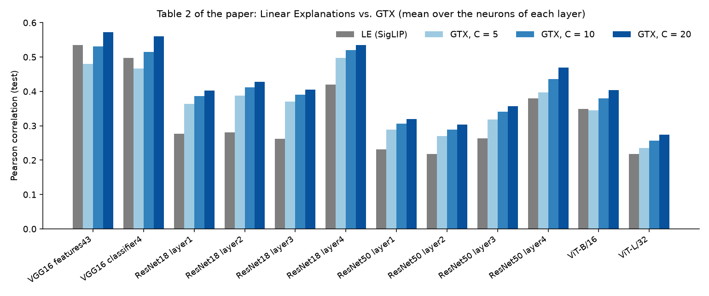
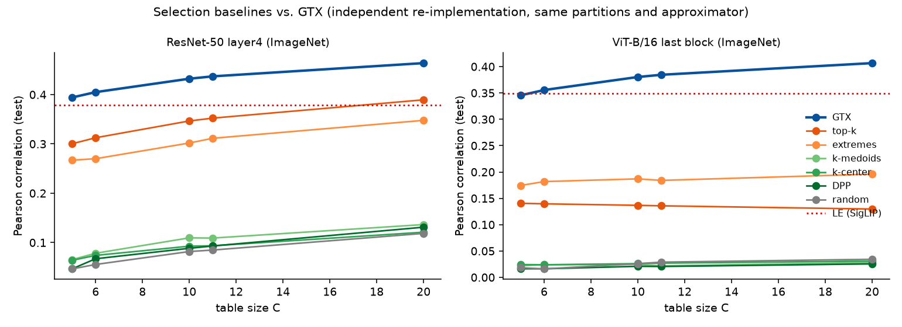
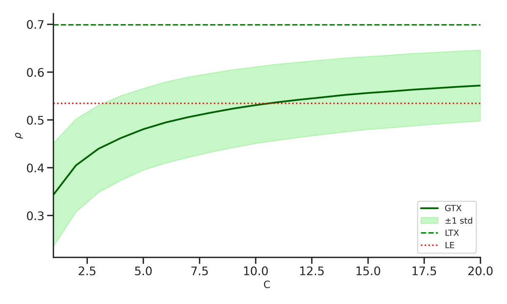

# GTX: Global Tabular eXplanations for Individual Neurons

Code and per-layer results for the paper *Global Tabular eXplanations for Individual Neurons* (preprint; link to be added).

A **Global Tabular eXplanation (GTX)** explains a single neuron with a small table of `C` input–activation pairs. A new input is approximated by
`u_weighted(x) = sim(x, x*) · u(x*)`, where `x*` is the most similar input in the table (cosine similarity in a feature space of a model *different*
from the explained one). The table is chosen to maximize the Pearson correlation between the true and the approximated activations, with a
two-stage search: `k`-means reduction of the training set (`k = 2000`; 500 for CIFAR-100) followed by a greedy search (Algorithm 1 of the paper).
The explanation *is* the table: the examples **below** the neuron's mean activation (red) are part of it, not only the top activations.



*Example: ResNet-50 `layer4`, neuron 163, table of C = 10 images from an open pool (Open Images CC BY 2.0 and PD12M public domain; credits in [`figures/CREDITS.md`](figures/CREDITS.md)).
Green: activation above the neuron's mean; red: below. More examples:
[`layer4`, neuron 1419](figures/gtx_pool_resnet50_layer4_u1419.png) and [`layer3`, neuron 546](figures/gtx_pool_resnet50_layer3_u546.png).
The tables of the paper use the images of ImageNet, Places365 and CIFAR-100, which are not redistributed here.*

## Headline results

Mean Pearson correlation on the held-out test partition between the true activations and the approximation, over **all the neurons** of each layer
(± standard error). Linear Explanations (LE, Oikarinen & Weng, 2024) is a top-performing dataset-based global method in recent benchmarks. **Bold**: GTX above LE.
Table 2 of the paper:

| Target model | LE (SigLIP) | C (LE) | GTX C=5 | GTX C=10 | GTX C=20 |
|---|---|---|---|---|---|
| VGG16 (features43) | 0.5347 ± 0.0131 | 6.0723 | 0.4806 ± 0.0038 | 0.5309 ± 0.0035 | **0.5719 ± 0.0033** |
| VGG16 (classifier4) | 0.4969 ± 0.0030 | 6.0859 | 0.4668 ± 0.0040 | **0.5142 ± 0.0037** | **0.5606 ± 0.0036** |
| ResNet18 (layer1) | 0.2766 ± 0.0130 | 3.9219 | **0.3638 ± 0.0109** | **0.3862 ± 0.0110** | **0.4022 ± 0.0111** |
| ResNet18 (layer2) | 0.2814 ± 0.0170 | 3.8359 | **0.3881 ± 0.0096** | **0.4118 ± 0.0098** | **0.4278 ± 0.0097** |
| ResNet18 (layer3) | 0.2621 ± 0.0191 | 3.8164 | **0.3698 ± 0.0063** | **0.3910 ± 0.0063** | **0.4050 ± 0.0063** |
| ResNet18 (layer4) | 0.4192 ± 0.0032 | 4.2402 | **0.4972 ± 0.0038** | **0.5208 ± 0.0036** | **0.5345 ± 0.0035** |
| ResNet50 (layer1) | 0.2318 ± 0.0042 | 3.2969 | **0.2891 ± 0.0045** | **0.3063 ± 0.0046** | **0.3196 ± 0.0046** |
| ResNet50 (layer2) | 0.2182 ± 0.0031 | 3.0684 | **0.2699 ± 0.0036** | **0.2886 ± 0.0037** | **0.3039 ± 0.0037** |
| ResNet50 (layer3) | 0.2633 ± 0.0026 | 3.6279 | **0.3179 ± 0.0028** | **0.3405 ± 0.0028** | **0.3573 ± 0.0028** |
| ResNet50 (layer4) | 0.3791 ± 0.0017 | 4.6929 | **0.3976 ± 0.0017** | **0.4362 ± 0.0016** | **0.4689 ± 0.0016** |
| ViT-B/16 | 0.3493 ± 0.00487 | 1.8216 | 0.3444 ± 0.0038 | **0.3794 ± 0.0041** | **0.4043 ± 0.0042** |
| ViT-L/32 | 0.2185 ± 0.0037 | 1.5244 | **0.2347 ± 0.0031** | **0.2568 ± 0.0033** | **0.2736 ± 0.0034** |

* With **5** examples GTX already beats LE in all the layers of ResNet-50 and ResNet-18 and in ViT-L/32; with **10** it does in 11 of the 12 layers.
* LE uses, on average, between 1.5 and 6.1 concepts; GTX is evaluated at fixed table sizes.



### Why the table has to be optimized for the neuron

We compared GTX with other ways of choosing the same number of rows (same approximator, partitions and metric): random, top-activating inputs, extremes
(highest and lowest activations), and three criteria that ignore the neuron (*k*-medoids, *k*-center, DPP). GTX is better than every baseline in all 12 layers
for `C = 5, 10, 20`; the strongest baselines (top-*k*, extremes) reach 32–84 % of its correlation, and the neuron-agnostic diversity criteria exceed random selection
by at most 0.07. Full table: [`results/`](results/tabla_resultados.md) and Appendix D of the paper.



The correlation grows with `C` with diminishing returns (VGG16 `features43`; the dotted line is LE; GTX crosses it at `C ≈ 11` in the original run):



## Contents

| Path | What |
|---|---|
| [`notebooks/GTX_original.ipynb`](notebooks/GTX_original.ipynb) | **Main code**: the original notebook (Google Colab) that produced the results of the paper, annotated cell by cell. Outputs cleared; the cells that ran Linear Explanations with its authors' code were replaced by a loader of its results. |
| `batched/src/bc_gtx.py` | Independent, batched GPU re-implementation (many neurons at once): GTX, the selection baselines, ETA estimation, open-pool mode and heat maps. Used for the baselines and the reproduction check. |
| `batched/src/bc_redes.py`, `bc_inactivas.py`, `splits_le.py` | Networks and layer pooling for the ImageNet networks; live / inhibitory / dead neurons; reconstruction of the LE partitions (the id files are not included). |
| `batched/hpc/bc16_gtx.sh`, `comun.example.sh` | Resumable Slurm launcher and an example of the cluster definitions (adapt to your cluster). |
| `batched/tests/prueba_gtx.py` | Tests with synthetic data (no GPU, no datasets): batched greedy search against the naive Algorithm 1, clustering, baselines, resumption, output format, pool mode, heat maps. |
| `analysis/tabla_resultados.py` | Summarizes the per-neuron `jsonl` outputs into mean ± standard error per network, layer, method and `C`. |
| `results/` | `tabla_resultados.csv` / `.md`: mean ± standard error of every run of the re-implementation (all methods, the layers of the paper with `C ∈ {5, 6, 10, 11, 20}`, extra layers and the open-pool runs with `C ∈ {5, 10}`). |
| `figures/` | Figures of this README (with [credits](figures/CREDITS.md) of the images). |

## The original notebook

`notebooks/GTX_original.ipynb` follows the pipeline of the paper: (1) activation `u(x)` of the layer for every image (spatial mean for convolutional layers, CLS token for ViTs);
(2) similarity features from a different model (ResNet-101 for the ViTs, Hugging Face ViT-B/16 for the convolutional networks); (3) k-means reduction, keeping the training input most similar
to each centroid; (4) greedy search of the table on the validation partition (`Corrs[idx][4:]` are the test correlations for `C = 1…20`); (5) the local approximators
and tables of selected percentiles; (6) the figures. It is meant to be run in Colab with the data in Google Drive; the first cells explain what has to be provided.

**Note on the local approximators.** The notebook computes `u_{κ=5}` with `N_approx(..., method="kNN", topk=5)`, whose default weighting is a *softmax* of the similarities and not the plain mean of Eq. (2) of the paper
(pass `weight="uniform"` for the mean). The comments in the notebook flag it.

## Methods of the re-implementation

`--metodos` accepts: `gtx`, `aleatorio` (random, five draws per neuron), `topk`, `extremos`, `kmedoids`, `kcenter`, `dpp` and `gtxpropio` (similarity computed with the explained layer's own activations: a leaky
upper bound, not a fair method). The greedy search is nested, so one run gives every `C ≤ max(C)`.

## Data and models (not included)

* **ImageNet-val** (50 000 images, parquet shards in `GTX_RAIZ/imagenet1k/data/validation-NNNNN-of-00014.parquet`), **Places365-val** (small version) and the **CIFAR-100** test set. Their images are *not* redistributed.
* **Partitions of Linear Explanations** (Oikarinen and Weng, 2024): `data/data_splits/{imagenet_val,places365_val,cifar100_val}/{train,val,test}_ids.pt` from the LE repository, placed under `GTX_REPO_LE`
  (default `~/clusters/ext/Linear-Explanations`). If they are missing the re-implementation falls back to a fixed-seed 70/10/20 split and labels the partition `semilla0`: such results are **not**
  comparable with LE. LE's code is not included (that repository has no license).
* Network weights: torchvision ResNet-50 (V1) and ViT-B/16 (V1), ViT-L/32, ResNet-18 trained on Places365, the `cifar100_vgg16_bn` model of `chenyaofo/pytorch-cifar-models` and, for similarity, torchvision's
  ResNet-101 and `google/vit-base-patch16-224`. `python batched/src/bc_gtx.py --plan descarga` and `--plan descarga_ext` fetch the ones that are not in torchvision's cache (run them where there is internet).

## Usage of the re-implementation

```bash
cp batched/hpc/comun.example.sh batched/hpc/comun.sh    # adapt to your cluster
# smoke test on one shard; it also prints an ETA of the full run (primitives measured at full size on synthetic data)
PLAN=humo ARGS="--red resnet50" bash batched/hpc/bc16_gtx.sh 1
# GTX on ResNet-50 (layers 1-4) with the tables of the paper, then the baselines
PLAN=evalua ARGS="--C 5,6,10,11,20 --metodos gtx --red resnet50 --capas layer1,layer2,layer3,layer4" bash batched/hpc/bc16_gtx.sh 4
PLAN=evalua ARGS="--C 5,6,10,11,20 --metodos aleatorio,topk,extremos,kmedoids,kcenter,dpp --red resnet50 --capas layer1,layer2,layer3,layer4" bash batched/hpc/bc16_gtx.sh 2
# summary table
python analysis/tabla_resultados.py <folder-with-the-jsonl-outputs>
# tests (CPU, synthetic data)
python batched/tests/prueba_gtx.py
```

The runs are resumable and idempotent: every job stops before a cell that does not fit in its time limit, rows are appended per neuron, and finished work is skipped (`--existe` exits with 0 when nothing is left).
Output: one JSON row per neuron with the selected examples (`indices`, in the order of the dataset), their activations, the correlation on the validation and test partitions, the neuron's mean activation on the
train partition, the partition used and the similarity model.

## Reproduction

The GTX results of the paper's Table 2 were obtained with the notebook. The batched re-implementation reproduces the 36 GTX values (12 layers × `C ∈ {5, 10, 20}`) on the same partitions within 0.015 in test
correlation (within 0.01 in 32 of 36); see Appendix E of the paper. The main differences are the clustering step (`k`-means++ with 40 Lloyd iterations on L2-normalized features, instead of scikit-learn with ten
restarts) and the batching of the greedy search. In the VGG16 `features43` layer the crossing point with LE moves from `C = 11` (notebook) to between `C = 11` and `C = 20`. The ablation score of Table 3 and the
local-method tables (4 and 5) are not reproduced by the re-implementation.

## License and third-party material

Code: MIT (see `LICENSE`). Linear Explanations, CLIP-Dissect and other third-party methods are not included. ImageNet, Places365 and CIFAR-100 are subject to their own terms; no images from them are distributed here.
The example images in `figures/` come from an open pool (Open Images, CC BY 2.0; PD12M, public domain) and are credited in `figures/CREDITS.md`.

## Citation

```
[to be added with the arXiv identifier]
```

---
*Repository assembled and original notebook annotated with the assistance of Claude (Anthropic), October 2026.*
